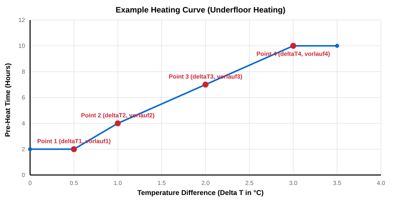
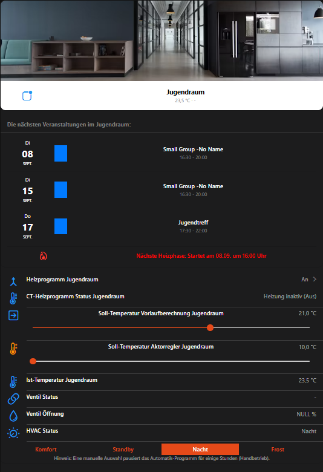
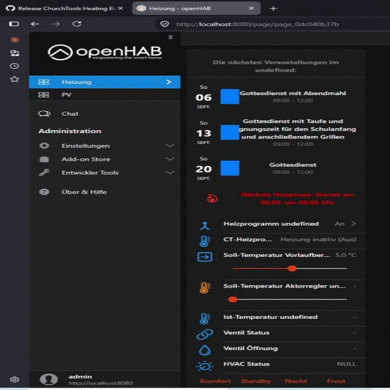

# ChurchTools Heating Binding for openHAB 5.x (5.1 / 5.2)

This binding integrates the [ChurchTools](https://church.tools/) API to automatically control heating and HVAC systems (especially KNX room controllers and actuators) in your building based on room bookings and calendars.

It allows you to map ChurchTools "Resources" (Rooms) to openHAB, calculates dynamic pre-heating times based on target and current room temperatures, supports energy-saving early shut-off before an event ends, and offers seamless bidirectional KNX manual override detection.

---

## Key Features

### 1. Pre-Heating Calculation (`Vorlaufzeit-Berechnung`) & Pre-Heat Latch
Instead of starting the heating right when an event begins, the binding calculates how long the room needs to heat up to reach the target temperature *before* the event starts.

It calculates the temperature difference (**Delta T**) between `targetTemperature` and `currentTemperature` and interpolates along a configurable 4-point heating curve in the Thing configuration:

- `deltaT1` -> `vorlauf1` (Default: `0.5 °C` diff = `1.0 h` pre-heating)
- `deltaT2` -> `vorlauf2` (Default: `1.0 °C` diff = `2.5 h` pre-heating)
- `deltaT3` -> `vorlauf3` (Default: `2.0 °C` diff = `5.0 h` pre-heating)
- `deltaT4` -> `vorlauf4` (Default: `4.0 °C` diff = `8.0 h` pre-heating)

If the temperature difference falls between two points (e.g., `1.5 °C`), the binding linearly interpolates the required pre-heat duration.
- **Pre-Heating Latch (Halte-Logik):** Once pre-heating has started for an upcoming event (`heatingRelay = ON`), rising room temperature during the warm-up phase will **not** shift the calculated start time forward or pause the heating midway. The room heats continuously until the scheduled heating end.

> [!IMPORTANT]
> **Room-Specific Curve:** Because every room has different heating systems (underfloor heating vs. radiators), room sizes, and insulation, you should configure the 4 points (`deltaT1-4` and `vorlauf1-4`) in the Thing configuration for *each individual room*.

#### Example Heating Curves (Muster-Heizkurven)

##### A. Underfloor Heating (Fußbodenheizung)
Underfloor heating systems react slowly. A typical configuration for a well-insulated building:
- **Punkt 1:** `deltaT1 = 0.5` °C ➔ `vorlauf1 = 2.0` h *(Only slightly cold, needs 2 hours to warm up)*
- **Punkt 2:** `deltaT2 = 1.0` °C ➔ `vorlauf2 = 4.0` h *(1 degree cold, needs 4 hours)*
- **Punkt 3:** `deltaT3 = 2.0` °C ➔ `vorlauf3 = 7.0` h *(2 degrees cold, needs 7 hours)*
- **Punkt 4:** `deltaT4 = 3.0` °C ➔ `vorlauf4 = 10.0` h *(3 degrees cold, needs 10 hours)*

##### B. Traditional Radiators (Heizkörper)
Standard wall radiators heat up the air much faster:
- **Punkt 1:** `deltaT1 = 0.5` °C ➔ `vorlauf1 = 0.5` h *(30 minutes to warm up)*
- **Punkt 2:** `deltaT2 = 1.0` °C ➔ `vorlauf2 = 1.0` h *(1 hour for 1 degree)*
- **Punkt 3:** `deltaT3 = 2.0` °C ➔ `vorlauf3 = 2.0` h *(2 hours for 2 degrees)*
- **Punkt 4:** `deltaT4 = 3.0` °C ➔ `vorlauf4 = 3.0` h *(3 hours for 3 degrees)*



---

### 2. Energy Saving: Early Shut-Off Before Event End (`earlyStopMinutes`)
With the configuration parameter **`earlyStopMinutes`** (*Vorzeitiges Abschalten vor Terminende (Minuten)*, `0`–`240` min), you can specify how many minutes *before* the official end of a booking the heating should turn off to utilize residual heat in the room.
- **Example:** An event ends at `12:00` and `earlyStopMinutes` is set to `30`. The heating turns off at `11:30` (`heatingRelay = OFF`, `hvacMode = offHvacMode`, `actuatorTargetTemp = offTemperature`), while the event itself remains visible in the upcoming events display until `12:00`.

---

### 3. Manual Override Detection (`Handbetrieb` via KNX Wall Controller or UI)
When `enableExternalManualMode` (*KNX Handbetrieb erlauben*, default: `true`) is enabled, the binding detects manual changes on physical KNX thermostats (e.g., MDT Glastaster, Zennio Z41) or in the openHAB UI and pauses automation for **`externalManualModeDuration`** hours (default: `6` hours):

1. **HVAC Operating Mode Changes (`hvacMode` / `knxHvacModeItem`):**
   - **When idle (no active event):** Switching to `1` (Comfort) or `2` (Standby) activates manual override for `externalManualModeDuration` hours (`heatingRelay = ON`, `actuatorTargetTemp = targetTemperature`). Switching back to `3` (Night) or `4` (Frost) immediately ends the manual override and turns heating `OFF`.
   - **During an active event:** Switching to `3` (Night) or `4` (Frost) activates a **manual OFF override** for `externalManualModeDuration` hours so the binding does not immediately force Comfort mode back on. Switching back to `1` (Comfort) cancels the OFF override and resumes normal event heating.
2. **Setpoint Temperature Changes (`actuatorTargetTemp` / `knxTargetTempItem`):**
   - Changing the actuator target temperature by **more than `1.0 °C`** (`|newTemp - expectedTemp| > 1.0 °C`) triggers a manual override for `externalManualModeDuration` hours.
   - **No HVAC Mode Change on Setpoint Adjustment:** A setpoint change **never** alters the `hvacMode` (Operating Mode). This prevents KNX wall controllers from overwriting your manually chosen temperature with their internal Comfort preset.
   - Once the manual override timer (`manualOverrideUntil`) expires, the binding automatically resets the actuator target temperature back to the scheduled setpoint (`offTemperature` when idle, or `targetTemperature` during an event).

**Resetting the Manual Override:**
The manual override is cleared when:
1. The `externalManualModeDuration` timer expires.
2. A **new** event heating phase starts in ChurchTools.
3. The user clicks the reset button in the MainUI widget (sends `UNDEF` or `OFF` to `manualOverrideUntil`).
4. While idle, the user manually sets the mode back to Night (`3`) / Frost (`4`) or lowers the setpoint to or below `offTemperature`.

---

### 4. Direct KNX Item Integration (No Rules or Profiles Required)
In addition to standard openHAB channel links, you can enter existing KNX item names directly in the `roomHeater` Thing configuration:
- **`knxHvacModeItem`** (*KNX Betriebsart Item (Direkt)*)
- **`knxTargetTempItem`** (*KNX Soll-Temperatur Item (Direkt)*)
- **`knxCurrentTempItem`** (*KNX Ist-Temperatur Item (Direkt)*)

The binding automatically reads their persisted state on startup, listens for state changes directly on the openHAB EventBus, and sends commands (`Komfort = 1` / `Nacht = 3` and target temperatures) bidirectionally to the configured KNX items.

---

### 5. Heating Automation Switch (`heatingEnabled`) & Summer Mode (`summerMode`)
- When `heatingEnabled` is switched to `OFF` (or `summerMode` to `ON`):
  - `heatingRelay` is immediately set to `OFF` and `actualHeatingStart` is cleared (`UNDEF`), so the green active heating banner in the widget turns off immediately.
  - **Smart KNX Shut-Off:** If the room was actively heating **because of the schedule automation** (not in manual override), the binding turns the heating off on the KNX bus **once** (`offHvacMode` and `offTemperature`).
  - **Preserving Manual Mode:** If the room was in **Manual Override (`Handbetrieb`)** or already idle when automation is turned off, the KNX bus is left completely untouched.
  - While `heatingEnabled` remains `OFF` (or `summerMode` is `ON`), the binding stays in **hands-off mode** and does not trigger manual override timers or green heating banners when the KNX thermostat is operated manually.
- When `heatingEnabled` is switched back to `ON` (and `summerMode` is `OFF`), the binding immediately re-evaluates the calendar and synchronizes the KNX actuators.

---

### 6. Two-Layer Polling & Fast Evaluation
1. **API Fetching (Cache):** Calendar bookings are fetched from ChurchTools every `refreshInterval` minutes (configured on the Bridge, default: `15` minutes) and cached in memory.
2. **Logic Evaluation (Every Minute):** The binding evaluates the cached bookings every 60 seconds and immediately upon relevant item changes.

---

### 7. Safety Filters (`Sicherheit & Filter`)
1. **Confirmed Bookings Only (`onlyConfirmedBookings`):** By default (`true`), only bookings with status "Confirmed" (*Bestätigt*) trigger heating.
2. **Maximum Event Duration (`enableMaxDurationFilter` / `maxEventDuration`):** By default (`true`, `10` hours), multi-day or accidentally overlong bookings exceeding `maxEventDuration` hours are ignored so a room is not heated for days on end.

---

## Supported Things

| Thing Type ID | Description |
|---|---|
| `api` | The Bridge to the ChurchTools API. |
| `roomHeater` | Represents a single room (Resource) that is heated automatically based on ChurchTools bookings. |

---

## Bridge Configuration (`api`)

| Parameter | Label (DE) | Type | Required | Default | Description |
|---|---|---|---|---|---|
| `url` | ChurchTools URL | text | Yes | | Base URL of your ChurchTools instance (e.g., `https://mychurch.church.tools`). |
| `token` | API Token | text | Yes | | Login token of a user with read permissions for resources/bookings. |
| `refreshInterval` | Aktualisierungsintervall (Minuten) | integer | No | `15` | How often (in minutes) bookings are fetched from the ChurchTools API. |
| `roomResourceTypeId` | Resource-Type ID für Räume | integer | No | `2` | The ID of the Resource Type for "Rooms" in ChurchTools. |

---

## Thing Configuration (`roomHeater`)

| Parameter | Label (DE) | Type | Required | Default | Description |
|---|---|---|---|---|---|
| `resourceId` | Ressourcen-ID | integer | Yes | | The ID of the Resource (Room) in ChurchTools. |
| `onlyConfirmedBookings` | Nur bestätigte Termine | boolean | No | `true` | Only use confirmed bookings for heating. |
| `enableMaxDurationFilter` | Lange Termine ignorieren | boolean | No | `true` | Ignore bookings that exceed `maxEventDuration`. |
| `maxEventDuration` | Maximale Termindauer (Stunden) | integer | No | `10` | Maximum duration (in hours) of an event to be considered for heating. |
| `enablePreheating` | Vorlaufzeit-Berechnung aktivieren | boolean | No | `true` | Calculate dynamic pre-heat time before event start using the 4-point curve. |
| `earlyStopMinutes` | Vorzeitiges Abschalten vor Terminende (Minuten) | integer | No | `0` | Turn off heating `X` minutes (`0`–`240`) before the event ends to save energy. |
| `enableExternalManualMode` | KNX Handbetrieb erlauben | boolean | No | `true` | Detect manual changes on KNX thermostats and pause automation. |
| `externalManualModeDuration` | Dauer Handbetrieb (Stunden) | integer | No | `6` | How long (in hours) automation pauses on manual override. |
| `knxHvacModeItem` | KNX Betriebsart Item (Direkt) | text | No | | Optional: Name of the external KNX HVAC mode item (direct bidirectional control without rules). |
| `knxTargetTempItem` | KNX Soll-Temperatur Item (Direkt) | text | No | | Optional: Name of the external KNX target temperature item (direct bidirectional control without rules). |
| `knxCurrentTempItem` | KNX Ist-Temperatur Item (Direkt) | text | No | | Optional: Name of the external KNX current temperature sensor item. |
| `offHvacMode` | Modus zum Ausschalten | integer | No | `3` | KNX HVAC mode when heating is OFF (`3` = Nacht, `4` = Frost, `2` = Standby; heating sends `1` = Komfort). |
| `offTemperature` | Temperatur zum Ausschalten (°C) | decimal | No | `17.0` | Setpoint temperature (`5.0`–`30.0 °C`) sent to `actuatorTargetTemp` / `knxTargetTempItem` when heating is OFF. |
| `deltaT1` ... `deltaT4` | Delta T1–T4 (°C) | decimal | No | `0.5`, `1.0`, `2.0`, `4.0` | Temperature differences (`targetTemperature - currentTemperature`) for the 4-point pre-heat curve. |
| `vorlauf1` ... `vorlauf4` | Vorlauf T1–T4 (Stunden) | decimal | No | `1.0`, `2.5`, `5.0`, `8.0` | Pre-heat durations (in hours) corresponding to `deltaT1` ... `deltaT4`. |

---

## Channels (`roomHeater`)

| Channel ID | Item Type | Read/Write | Description |
|---|---|---|---|
| `currentTemperature` | `Number:Temperature` | R/W | Current measured room temperature. |
| `targetTemperature` | `Number:Temperature` | R/W | Desired target temperature during events (and basis for pre-heat calculation). |
| `actuatorTargetTemp` | `Number:Temperature` | R/W | Active setpoint sent to the KNX actuator (switches between `targetTemperature` when heating and `offTemperature` when idle; manual changes `> 1.0 °C` trigger manual override without changing `hvacMode`). |
| `heatingRelay` | `Switch` | R/W | Calculated heating state (`ON` during pre-heating/event or manual heat override, `OFF` when idle). |
| `hvacMode` | `Number` | R/W | Bidirectional KNX HVAC mode (`1` = Komfort, `2` = Standby, `3` = Nacht, `4` = Frost). |
| `heatingStart` | `DateTime` | Read-Only | Calculated timestamp when pre-heating will start (latched once pre-heating is active). |
| `actualHeatingStart` | `DateTime` | Read-Only | Actual timestamp when `heatingRelay` switched to `ON` (`UNDEF` when `OFF`). |
| `manualOverrideUntil` | `DateTime` | R/W | Timestamp until which automation is paused due to manual override (send `UNDEF` or `OFF` to reset). |
| `heatingEnabled` | `Switch` | R/W | Master switch to enable/disable heating automation for this room. |
| `summerMode` | `Switch` | R/W | Switch to enable/disable summer mode (no heating). |
| `upcomingEvent1` | `String` | Read-Only | Title of the 1st upcoming (or currently active) event. |
| `nextEventStart` | `DateTime` | Read-Only | Start time of the 1st upcoming event. |
| `nextEventEnd` | `DateTime` | Read-Only | End time of the 1st upcoming event. |
| `upcomingEvent2` | `String` | Read-Only | Title of the 2nd upcoming event. |
| `nextEvent2Start` | `DateTime` | Read-Only | Start time of the 2nd upcoming event. |
| `nextEvent2End` | `DateTime` | Read-Only | End time of the 2nd upcoming event. |
| `upcomingEvent3` | `String` | Read-Only | Title of the 3rd upcoming event. |
| `nextEvent3Start` | `DateTime` | Read-Only | Start time of the 3rd upcoming event. |
| `nextEvent3End` | `DateTime` | Read-Only | End time of the 3rd upcoming event. |

---

## UI Widget

A pre-built openHAB MainUI Widget is included in this repository at:
**`widget/churchtools_room_widget.json`**

Import this file under **Developer Tools -> Widgets** in openHAB MainUI. It displays upcoming events, current/target temperatures, active pre-heating banners, HVAC mode buttons, and manual override countdowns with a one-click reset.



---

## Full Configuration Example

### `churchtools.things`
```java
Bridge churchtoolsheating:api:mychurch "ChurchTools API" [ url="https://mychurch.church.tools", token="YOUR_TOKEN", refreshInterval=15 ] {
    Thing roomHeater saal "Saal Heizung" [
        resourceId=12,
        onlyConfirmedBookings=true,
        enablePreheating=true,
        earlyStopMinutes=30,
        enableExternalManualMode=true,
        externalManualModeDuration=4,
        offHvacMode=3,
        offTemperature=15.0,
        knxHvacModeItem="Heizung_Saal_HVAC",
        knxTargetTempItem="Heizung_Saal_Soll",
        knxCurrentTempItem="Heizung_Saal_Ist"
    ]
}
```

### `churchtools.items`
```java
// Global Items
Switch Global_summerMode "Sommerbetrieb"

// Room Items (Saal)
Number:Temperature Raum_Saal_currentTemperature "Ist-Temperatur [%.1f °C]" { channel="churchtoolsheating:roomHeater:mychurch:saal:currentTemperature" }
Number:Temperature Raum_Saal_targetTemperature "Soll-Temperatur Vorlauf [%.1f °C]" { channel="churchtoolsheating:roomHeater:mychurch:saal:targetTemperature" }

Switch Raum_Saal_heatingRelay "Heizungsrelais (Heizphase aktiv)" { channel="churchtoolsheating:roomHeater:mychurch:saal:heatingRelay" }
Number Raum_Saal_hvacMode "HVAC Modus" { channel="churchtoolsheating:roomHeater:mychurch:saal:hvacMode" }
Number:Temperature Raum_Saal_actuatorTargetTemp "Aktuelle Aktor-Soll-Temperatur [%.1f °C]" { channel="churchtoolsheating:roomHeater:mychurch:saal:actuatorTargetTemp" }

Switch Raum_Saal_heatingEnabled "Heizautomatik An/Aus" { channel="churchtoolsheating:roomHeater:mychurch:saal:heatingEnabled" }
Switch Raum_Saal_summerMode "Sommerbetrieb Saal" { channel="churchtoolsheating:roomHeater:mychurch:saal:summerMode" }
DateTime Raum_Saal_manualOverrideUntil "Handbetrieb Pause bis [%1$tH:%1$tM]" { channel="churchtoolsheating:roomHeater:mychurch:saal:manualOverrideUntil" }

DateTime Raum_Saal_nextEventStart "Nächster Termin Start [%1$td.%1$tm. %1$tH:%1$tM]" { channel="churchtoolsheating:roomHeater:mychurch:saal:nextEventStart" }
DateTime Raum_Saal_nextEventEnd "Nächster Termin Ende [%1$td.%1$tm. %1$tH:%1$tM]" { channel="churchtoolsheating:roomHeater:mychurch:saal:nextEventEnd" }
DateTime Raum_Saal_heatingStart "Geplanter Heizbeginn [%1$td.%1$tm. %1$tH:%1$tM]" { channel="churchtoolsheating:roomHeater:mychurch:saal:heatingStart" }
DateTime Raum_Saal_actualHeatingStart "Tatsächlicher Heizbeginn [%1$tH:%1$tM]" { channel="churchtoolsheating:roomHeater:mychurch:saal:actualHeatingStart" }
String Raum_Saal_upcomingEvent1 "Nächster Termin: [%s]" { channel="churchtoolsheating:roomHeater:mychurch:saal:upcomingEvent1" }
```


